# llm-gateway

A small proxy that sits between your apps and one or more LLM providers. It speaks the OpenAI API, so existing clients only need a different base URL.

It handles the parts that get repetitive once several services call LLMs: spreading load across providers, falling back when one fails, pooling API keys, queueing, and rate limiting per client.

```
client A ─┐                                       ┌─▶ provider 1 (keys k1, k2)
client B ─┼─▶ llm-gateway ─────────────────────────┼─▶ provider 2 (key k3)
client C ─┘   auth, rate limit, route, queue      └─▶ local Ollama (no key)
              retry, key rotation
```

No runtime dependencies. Node 22.18+ runs the TypeScript sources directly.

## What it does

- Proxies `POST /v1/*` (chat completions, embeddings, ...) to any OpenAI-compatible API, and passes streaming responses through. `GET /v1/models` lists the models from the config.
- Picks the least-loaded provider that serves the requested model. Load is in-flight requests relative to `maxConcurrent`, divided by `weight`.
- Speaks other APIs too: Anthropic (Claude) and Google Gemini out of the box, and any other JSON chat API through a mapping you describe in the config or the dashboard. Clients keep using the OpenAI API ([details](#other-api-formats)).
- Retries on the next provider after a network error, a timeout or a 5xx. A provider that keeps failing is skipped for a cooldown period (circuit breaker). Client errors (4xx) are returned as they are.
- Keeps several upstream keys per provider and rotates through them. A key that gets a 429 (honouring `Retry-After`) or a 401/403 is put on cooldown and the next key is used.
- Limits concurrency per provider with a bounded wait queue. When the queue is full or the wait times out, it answers 503 with `Retry-After`.
- Authenticates clients with their own keys and rate limits each one (token bucket). Upstream keys are never exposed to clients.
- Writes JSON access logs (no secrets, failures included) and exposes Prometheus metrics.
- Serves an [admin dashboard](#admin-dashboard) at `/admin`: live traffic, failures, latency and request history, plus editable settings (providers, keys, clients, balancer) that apply without a restart.

## Running it

```bash
npm install
cp config.example.json config.json
cp .env.example .env        # keys referenced as "env:NAME" in config.json
npm start
```

`npm start` reads `config.json` (or the file in `CONFIG_PATH`) and loads `.env` if it exists. With Docker, `docker compose up --build` mounts `config.json` and loads `.env` for you.

```bash
curl http://localhost:8080/v1/chat/completions \
  -H "Authorization: Bearer $GATEWAY_KEY_TEAM_A" \
  -H "Content-Type: application/json" \
  -d '{"model":"gpt-4o-mini","messages":[{"role":"user","content":"Hello"}]}'
```

```python
from openai import OpenAI
client = OpenAI(base_url="http://localhost:8080/v1", api_key="<gateway key>")
```

Responses carry `x-gateway-provider` (which provider answered) and `x-request-id`.

To manage the gateway from the browser, set `GATEWAY_ADMIN_KEY` in `.env` and open `http://localhost:8080/admin` (see [Admin dashboard](#admin-dashboard)).

## Configuration

See [`config.example.json`](config.example.json). Any key can be written as `"env:NAME"` to read it from the environment.

| Field | Default | Meaning |
|---|---|---|
| `port` | `8080` | Listen port |
| `adminKey` | unset | Key for the `/admin` dashboard. If unset, the dashboard is disabled. Only editable in the file or environment |
| `clientKeys[]` | `[]` | `{ name, key, ratePerMinute }`. If empty, authentication is off and a warning is logged |
| `providers[].name`, `baseUrl` | required | Any OpenAI-compatible API (OpenAI, Ollama, vLLM, LiteLLM, ...) |
| `providers[].keys` | `[]` | Upstream keys. Empty means no `Authorization` header |
| `providers[].weight` | `1` | Higher weight gets proportionally more traffic |
| `providers[].maxConcurrent`, `queueSize` | `8`, `32` | Concurrent requests allowed and queue length |
| `providers[].models` | `[]` | Models served. Empty means any |
| `providers[].format` | `openai` | API the provider speaks: `openai`, `anthropic`, `gemini` or `custom` ([details](#other-api-formats)) |
| `providers[].adapter` | none | The mapping for `custom`, or overrides on top of a preset |
| `upstreamTimeoutMs` | `60000` | Time to wait for the upstream response headers |
| `queueTimeoutMs` | `10000` | Longest a request waits in a queue |
| `maxAttempts` | `3` | Upstream attempts per request |
| `breaker.failures`, `breaker.cooldownMs` | `3`, `15000` | Consecutive failures that open the breaker, and for how long |
| `keyCooldownMs` | `30000` | Cooldown for a rate-limited key when the upstream sends no `Retry-After` |

## Other API formats

Your clients always speak the OpenAI chat API. A provider that does not can still sit behind the gateway: set its `format` and the gateway rewrites each request into the API the provider expects, then turns the answer (or the event stream) back into an OpenAI reply.

| `format` | For | Base URL | Key goes in |
|---|---|---|---|
| `openai` | Anything OpenAI-compatible (default, requests pass through untouched) | `https://api.openai.com/v1` | `Authorization: Bearer` |
| `anthropic` | Claude, Messages API | `https://api.anthropic.com/v1` | `x-api-key` (plus `anthropic-version`) |
| `gemini` | Google Gemini, `generateContent` | `https://generativelanguage.googleapis.com/v1beta` | `x-goog-api-key` |
| `custom` | Any other JSON API, described by you | wherever it lives | whatever you configure |

```json
{ "name": "claude", "baseUrl": "https://api.anthropic.com/v1", "format": "anthropic",
  "keys": ["env:ANTHROPIC_API_KEY"], "models": ["claude-sonnet-4-5"], "weight": 2 }
```

A client then asks for `"model": "claude-sonnet-4-5"` on `/v1/chat/completions` like with any other provider, and balancing, failover, key rotation, rate limits and the dashboard all work the same.

What is translated, and what is not:

- Plain text chat: system and developer messages, user and assistant turns, `max_tokens`, `temperature`, `top_p`, `stop`, streaming (`stream: true`), the finish reason and token usage.
- Not translated: tool calls, images and audio, `n > 1`, JSON-schema output, and every other endpoint (embeddings and so on). A request that needs any of these is only offered to OpenAI-compatible providers. If none can serve the model, the client gets a `503` that says why.
- A `4xx` from the provider reaches the client as an OpenAI-style error (`type: "upstream_error"`) with the provider's own message. A `5xx`, a timeout, or an answer the mapping cannot read counts as a failure and the request fails over to the next provider.
- Presets can be tuned without rewriting them, for example `"adapter": { "headers": { "anthropic-beta": "..." }, "defaults": { "max_tokens": 8192 } }`. Anthropic requires `max_tokens`, so the preset defaults it to 4096 when the client sends none.

### Describing your own API

`format: "custom"` takes an `adapter` that says how to call the API and where to find the answer. Everything is data: no code, no restart.

```json
{
  "name": "acme",
  "baseUrl": "https://api.acme.example",
  "format": "custom",
  "keys": ["env:ACME_KEY"],
  "models": ["acme-large"],
  "adapter": {
    "path": "/v2/complete",
    "auth": { "header": "X-Acme-Key", "scheme": "" },
    "defaults": { "max_tokens": 1024 },
    "request": { "input": { "text": "{{last_user}}", "limit": "{{max_tokens}}" }, "creative": "{{temperature}}" },
    "response": {
      "text": "result.items[*].out",
      "finishReason": "result.why",
      "finishMap": { "DONE": "stop" },
      "promptTokens": "tokens.in",
      "completionTokens": "tokens.out",
      "error": "problem.text"
    }
  }
}
```

| Field | Meaning |
|---|---|
| `path` | Added to `baseUrl`. May contain `{{model}}` (URL-encoded), as in `/models/{{model}}:generateContent`. |
| `auth.header`, `auth.scheme` | Where the key goes. Default `Authorization` with `Bearer`. An empty scheme sends the bare key. |
| `headers` | Static extra headers. Keep keys out of here, use `keys`. |
| `defaults.max_tokens` | Used when the client sends no `max_tokens`. |
| `request` | The JSON body template. See the rules below. |
| `response.text` | Path to the reply text. **Required.** |
| `response.finishReason`, `finishMap` | Why it stopped, and how the provider's values map to `stop`, `length` or `content_filter`. Common values (`end_turn`, `max_tokens`, `STOP`, `MAX_TOKENS`, ...) are already known. |
| `response.promptTokens`, `completionTokens`, `id`, `model` | Optional, fill the OpenAI `usage`, `id` and `model`. |
| `response.error` | Path to the provider's error message, shown to clients when it rejects a request. |
| `streaming` | Omit it (or set `null`) if the API cannot stream: `stream: true` requests then get the full reply in one piece. Otherwise `{ "text": path, "finishReason": path, "path": "optional other path" }`, read from each server-sent event. |

**Template rules.** A string that is exactly `"{{name}}"` is replaced by the value itself, whatever its type (number, list, object). A placeholder inside a longer string is inserted as text. A variable the client did not send removes its key, and an object or list that ends up empty because of that is removed too, so optional parameters just disappear.

| Variable | Value |
|---|---|
| `{{model}}` | The model the client asked for |
| `{{stream}}` | `true` when the reply is streamed from the provider |
| `{{max_tokens}}` | `max_tokens` or `max_completion_tokens`, else `defaults.max_tokens` |
| `{{temperature}}`, `{{top_p}}`, `{{stop}}` | As sent by the client (`stop` is always a list) |
| `{{system}}` | All system and developer messages joined |
| `{{messages}}` | User and assistant turns as `[{ role, content }]`, without system messages (Anthropic style) |
| `{{all_messages}}` | Every message, system included, as `[{ role, content }]` |
| `{{gemini_contents}}` | Turns as `[{ role: "user" \| "model", parts: [{ text }] }]` |
| `{{last_user}}` | Text of the last user message |
| `{{transcript}}` | The whole conversation as one text, a `role: text` line per message |

**Paths** look like `a.b[0].c`. `[*]` collects every element of a list and joins the texts, so `content[*].text` reads all the blocks of a Claude answer.

**Building one in the dashboard.** In **Settings → Providers**, choose *API format* (or add a provider from the *Custom API* preset). The editor has a field for each part above, plus buttons that insert the variables. *Send test message* sends a real sample through the mapping, before you save, and shows the request that went out (keys masked), the raw answer, and the OpenAI reply it was translated into. If the mapping does not match, you see the provider's raw answer next to the error, which is usually all you need to fix the paths.

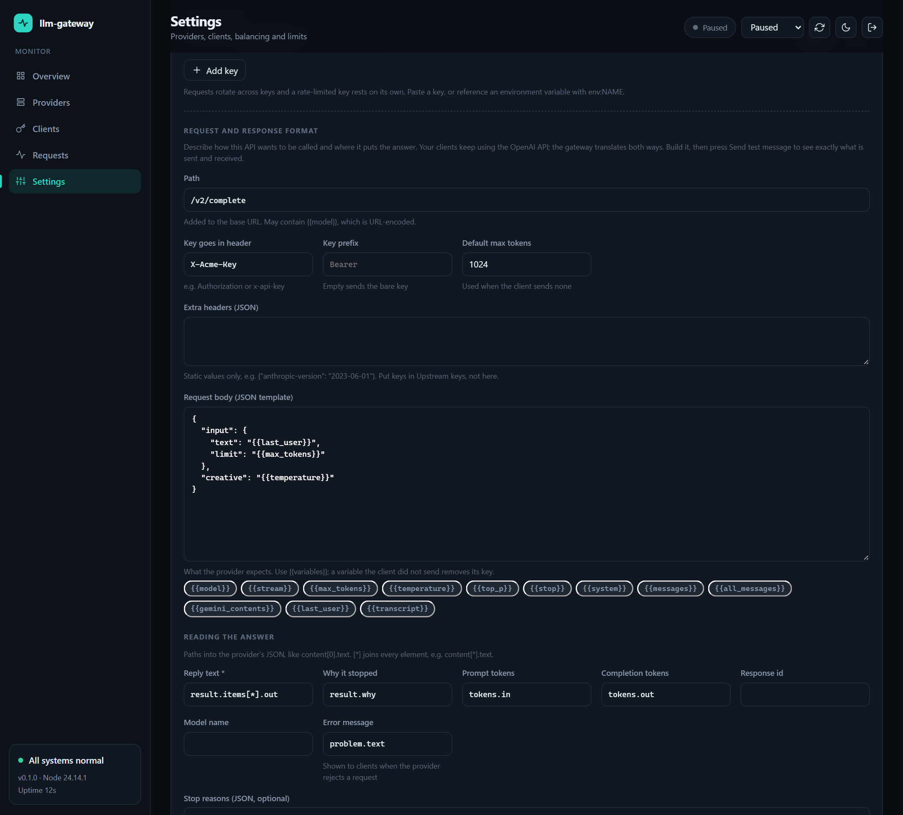

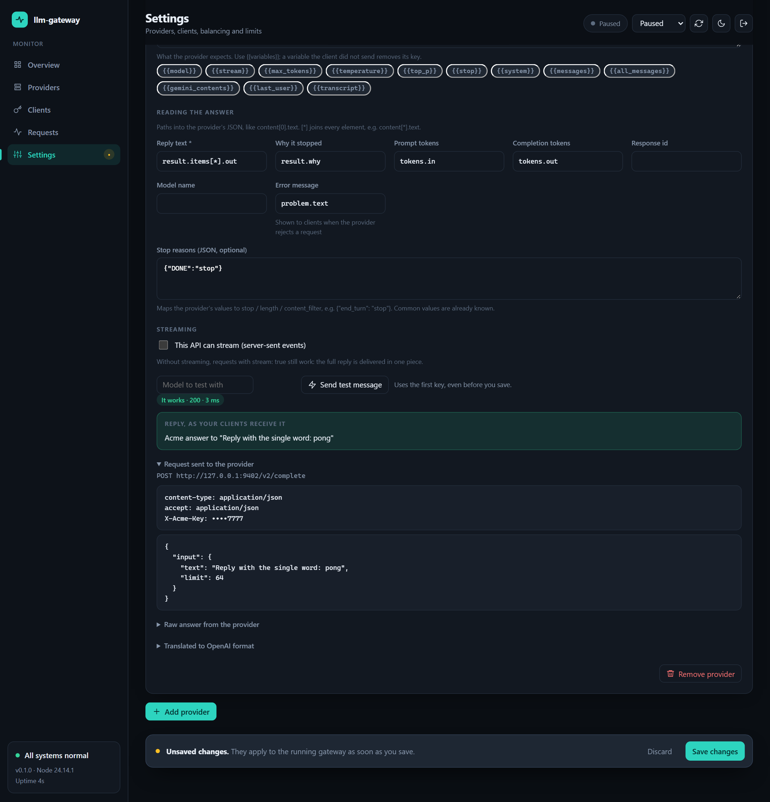

## Endpoints

| Endpoint | Auth | |
|---|---|---|
| `POST /v1/*` | client key | Proxied to a provider |
| `GET /v1/models` | client key | Models from the config |
| `GET /healthz` | none | Breaker state, in-flight and queued requests per provider |
| `GET /metrics` | none | Prometheus metrics |
| `GET /admin` | none | Dashboard page (contains no data) |
| `/admin/api/*` | admin key | JSON API behind the dashboard, see [Admin API](#admin-api) |

`/healthz` and `/metrics` contain no secrets but are not authenticated, so keep them on an internal network.

Metrics: `gateway_upstream_requests_total{provider,status}`, `gateway_retries_total{provider,reason}`, `gateway_rejected_total{reason}`, and the gauges `gateway_provider_inflight`, `gateway_provider_queued` and `gateway_provider_breaker_open`.

## Admin dashboard

A built-in web panel to watch the gateway and change its settings without touching files or restarting. It is one HTML page served by the gateway itself (no build step, no external assets), with a dark and a light theme, and it works on phones.

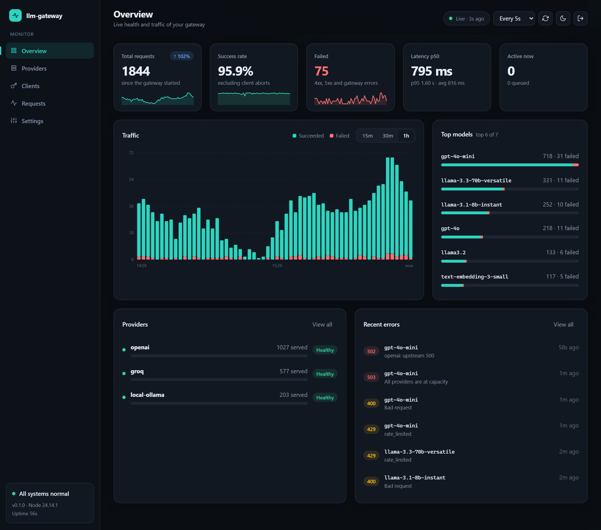

### Turn it on

1. Pick an admin key and put it in your config (the example config already does this):

   ```json
   { "adminKey": "env:GATEWAY_ADMIN_KEY" }
   ```

   ```bash
   # .env
   GATEWAY_ADMIN_KEY=a-long-random-string
   ```

2. Start the gateway and open **http://localhost:8080/admin**.
3. Sign in with the admin key. It lives in the tab's `sessionStorage` and is sent as a Bearer token; closing the tab signs you out.

Without `adminKey` the dashboard is disabled (`/admin` answers 404).

### Tour

Use the sidebar, or press `1` to `5`.

**Overview** shows total, failed and aborted requests, success rate, p50/p95 latency, a traffic chart (15 min, 30 min or 1 h; hover a bar for the exact numbers), the most used models, provider health and the latest errors. Click a model to see its requests. A banner appears when a circuit breaker is open, every key of a provider is cooling down, a queue is almost full, or client authentication is off.

**Providers** shows, per provider: load, queue, breaker state, how many requests it served, and each upstream key (masked) with its usage and cooldown. A routing matrix shows which provider can serve which model. If a provider is unhealthy, *Reset breaker & cooldowns* puts it back in rotation right away.

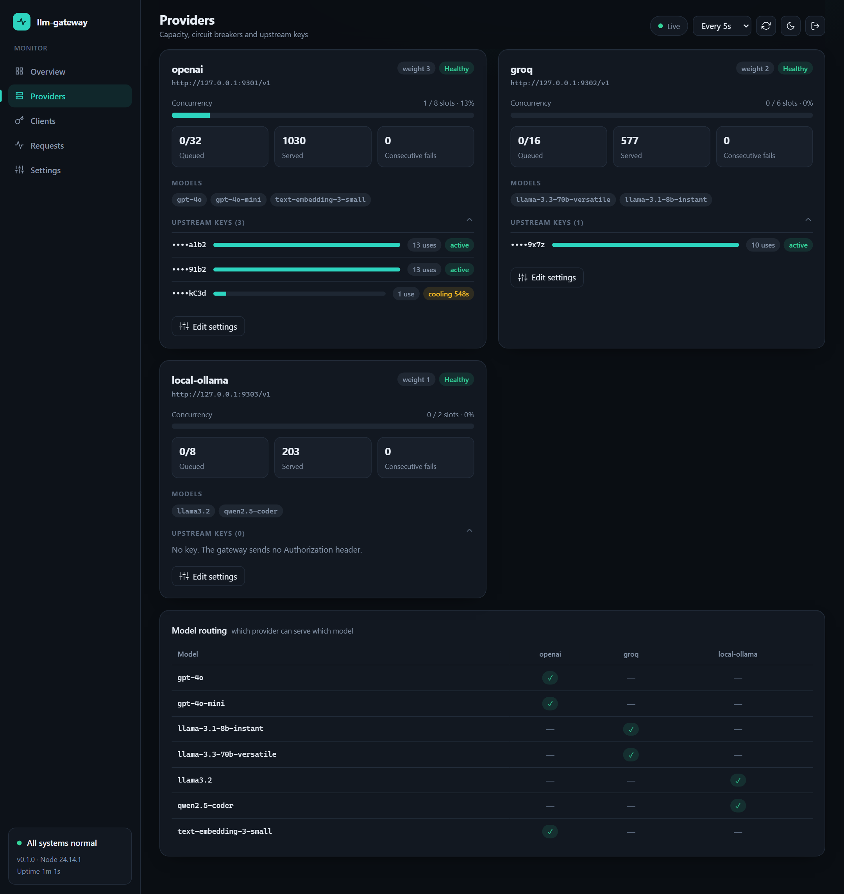

**Clients** lists your gateway keys with their rate limit, usage and failure rate. Click a client to see only its requests.

**Requests** keeps the last 200 requests in memory. Search by model, client, error or request ID, filter by status, model, provider or client, sort any column, and export the current view to CSV. Click a row for the details: status, latency, number of attempts, which provider answered, and the error.

| List | Detail |
|---|---|
| 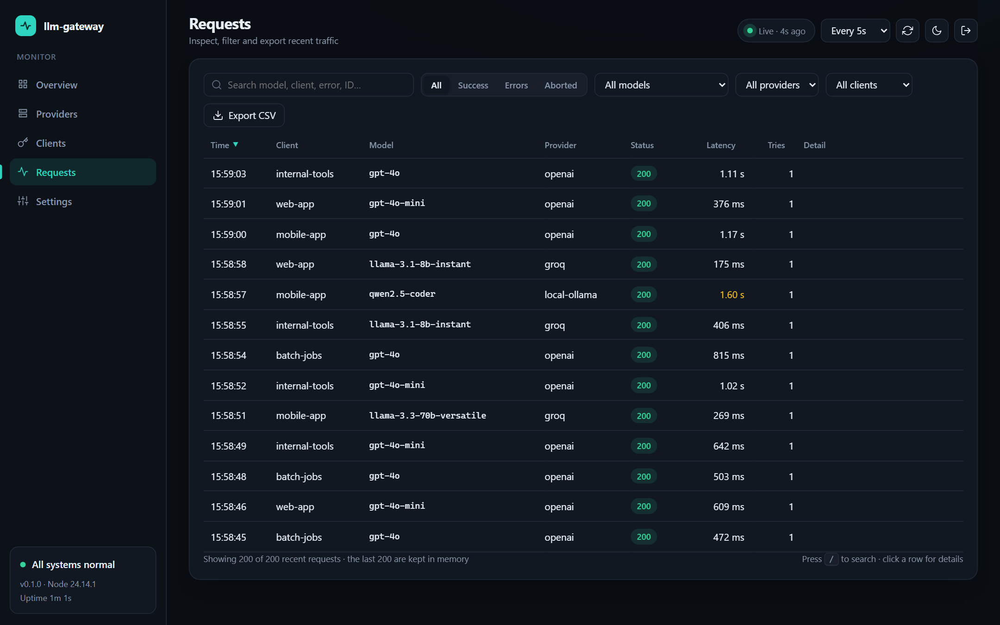 | 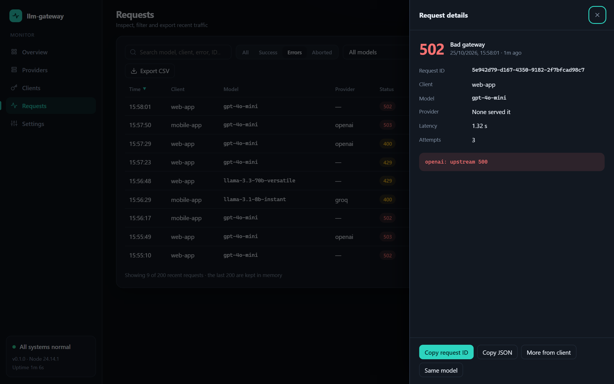 |

### Change settings

**Settings** edits the same `config.json` the gateway started with and applies the result to the running process. Nothing is saved until you press **Save changes**; a bar at the bottom tells you there is a pending draft, and *Discard* throws it away.

**Providers.** Add one from a preset (OpenAI, OpenRouter, Groq, Together AI, Mistral, DeepSeek, Anthropic, Gemini, Ollama, LM Studio), a custom OpenAI-compatible URL, or your own API format, then edit its name, API format, base URL, weight, concurrency, queue size and models. *Test connection* calls `GET {baseUrl}/models` with the provider's own key and offers to fill in the model list for you.

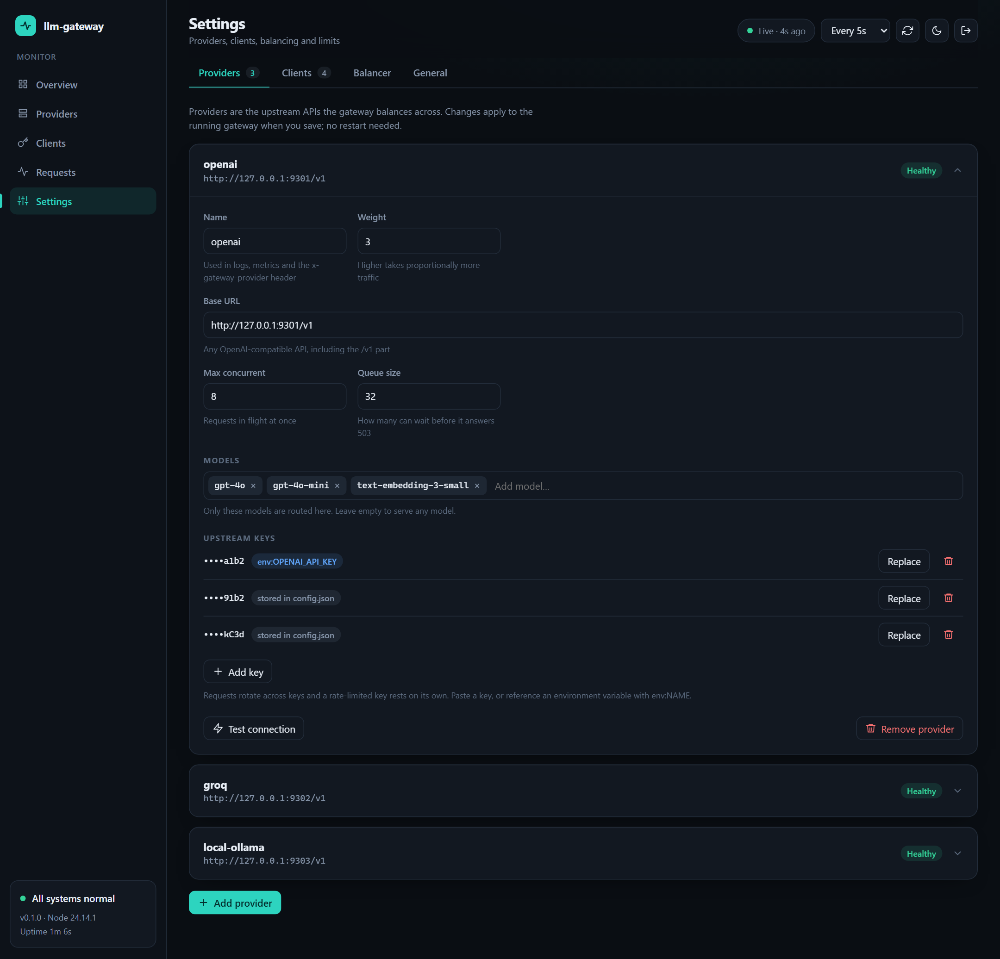

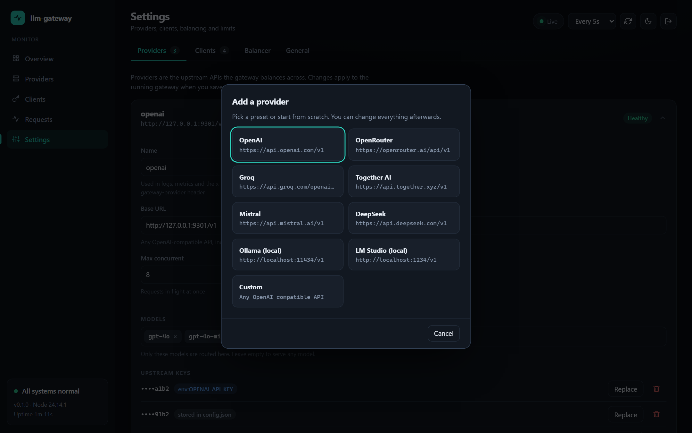

**API format.** Each provider has an *API format* selector. Anthropic and Gemini work out of the box; for any other API you describe the request and the response yourself and test it live. See [Other API formats](#other-api-formats).

**Upstream keys.** Add, replace or remove keys of a provider. Paste the key, or type `env:NAME` to read it from an environment variable; references are kept exactly as written, so a key that came from `.env` stays out of `config.json`. Existing keys are only ever shown as their last four characters.

**Clients.** Add or remove gateway keys and set each one's rate limit. A key can be generated for you (shown once, right after saving, with a copy button), rotated, or typed in by hand.

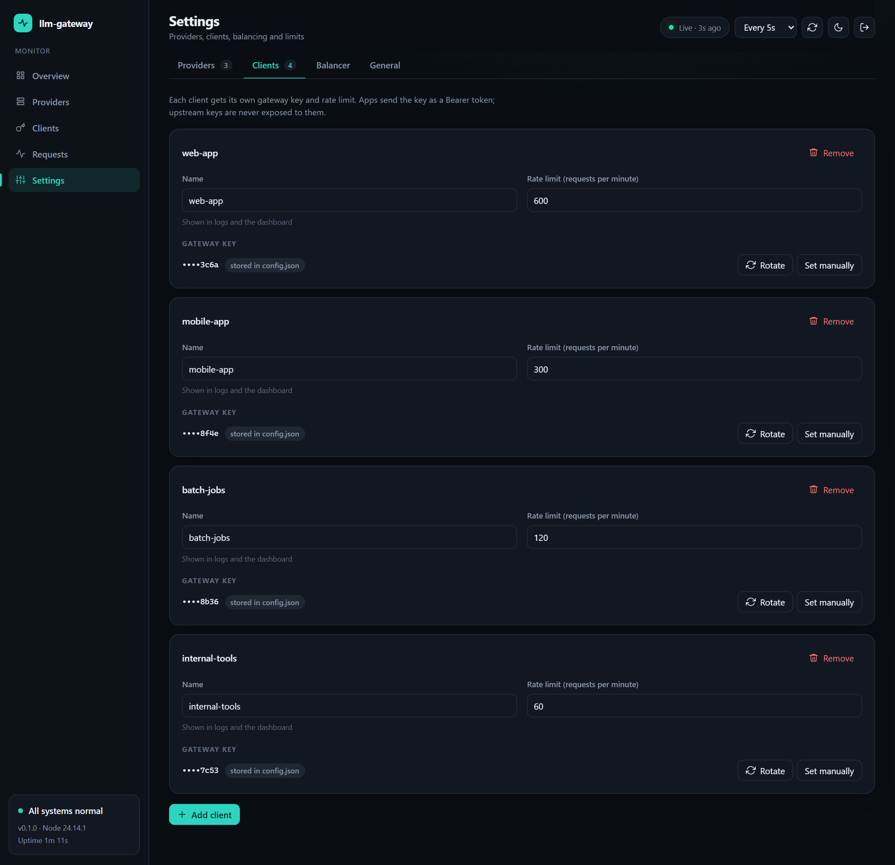

**Balancer.** Sliders set each provider's weight and show the traffic share you get when all providers are equally busy. Below are the failover knobs: max attempts, upstream and queue timeouts, circuit breaker threshold and cooldown, and the default key cooldown.

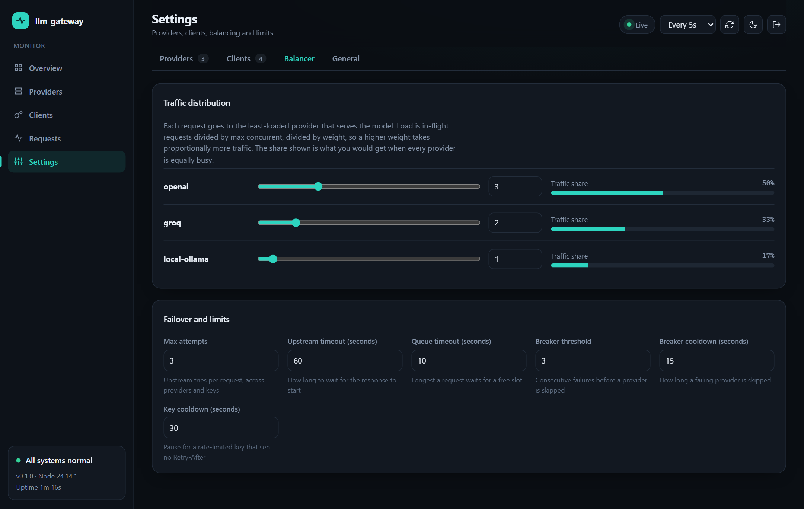

How saving works:

- The server validates the whole draft first and reports each problem next to its field (duplicate names, bad URLs, a client key that is too short, an `env:` variable that is not set, numbers out of range). If anything is wrong, nothing is written.
- On success the previous file is copied to `config.json.bak`, the new one is written, and the gateway switches to it immediately. Requests already in flight finish normally.
- A provider whose settings did not change keeps its live state (breaker, key cooldowns, queue). A provider you edited starts fresh.
- Removing every client key turns authentication off, so the panel asks you to confirm.

**General** shows the version, uptime, memory and port, and has a button to reset the statistics.

### Good to know

- **The config file must be writable.** With Docker, `docker-compose.yml` mounts `config.json` read-write; the container runs as the `node` user, so run `chmod a+rw config.json` (or `chown 1000 config.json`) once. If the file cannot be written, Settings stays read-only and tells you why.
- **Keys typed into the panel are saved in plain text** in `config.json`, like any key you would paste there. Use `env:NAME` to keep secrets in the environment instead. Keep `config.json` and `config.json.bak` out of version control (they are in `.gitignore`).
- **The admin key and the port cannot be changed from the panel**, so a typo can never lock you out. Edit the file or the environment and restart.
- **Statistics live in memory** and reset when the gateway restarts. Requests that the client abandons, or streams cut after they started, are counted as `499 aborted` and not as failures.
- **Brute force protection:** ten wrong admin keys within a minute lock the admin API for a minute.
- **Use HTTPS or a private network.** The admin key travels in a request header, like your client keys do. The page sends a strict Content-Security-Policy and renders every value as text.

### Keyboard shortcuts

| Key | Action |
|---|---|
| `1` to `5` | Overview, Providers, Clients, Requests, Settings |
| `/` | Search requests |
| `r` | Refresh now |
| `t` | Toggle light and dark theme |
| `Esc` | Close the detail panel or leave the search box |

The refresh interval (5 s, 15 s, 30 s or paused), theme and chart range are remembered in your browser.

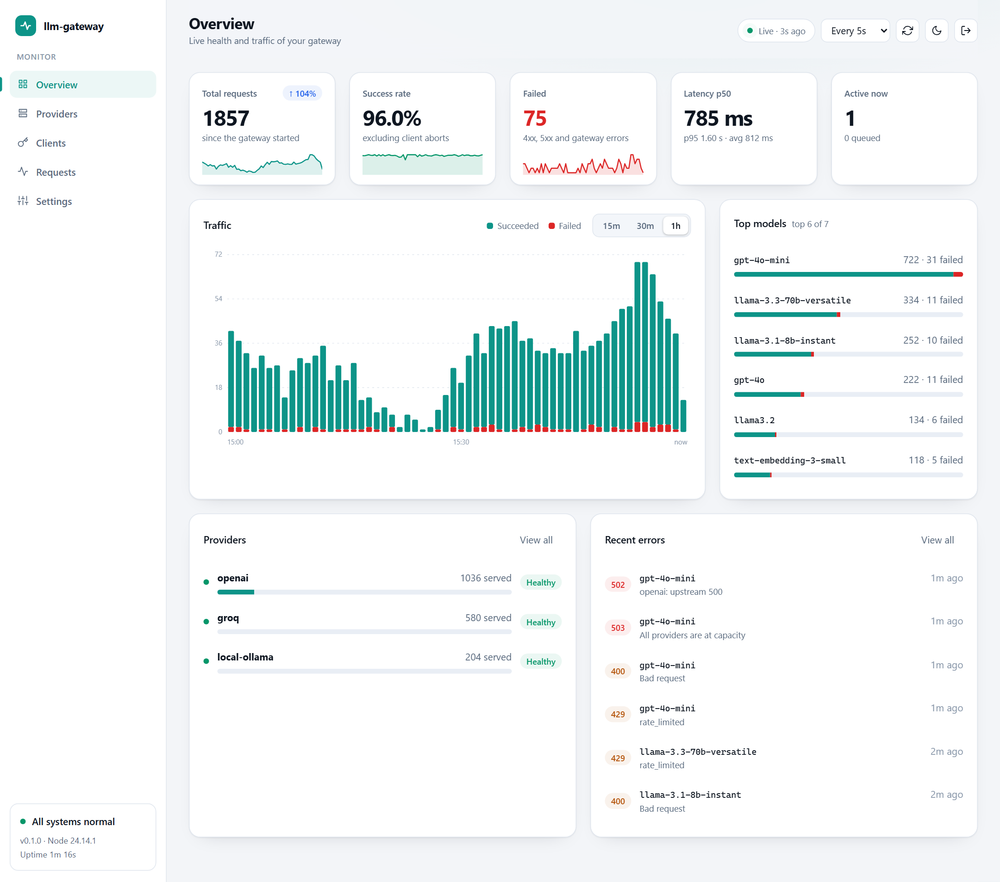

<p align="center">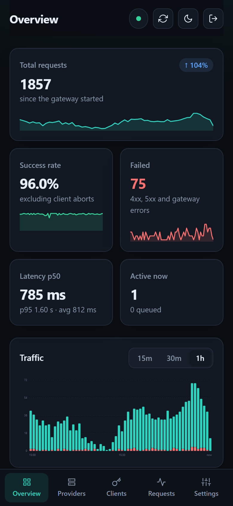</p>

### Admin API

The dashboard is a client of a small JSON API. Everything below needs `Authorization: Bearer <adminKey>`.

| Endpoint | |
|---|---|
| `GET /admin/api/overview` | Totals, series, models, providers, clients, recent requests |
| `GET /admin/api/config` | Editable config; secrets masked |
| `PUT /admin/api/config` | Validate and apply a draft. `422` with `{ error: { issues: [{ path, message }] } }` if invalid |
| `POST /admin/api/test` | Probe `GET {baseUrl}/models` for a provider (`{ provider }`) or typed values (`{ baseUrl, key }`) |
| `POST /admin/api/test-chat` | Send one sample chat through a provider definition, saved or not. Returns what was sent (keys masked), the raw answer and the translated reply |
| `POST /admin/api/providers/:name/reset` | Close the breaker and clear key cooldowns |
| `POST /admin/api/stats/reset` | Clear statistics |

## Request flow

1. Check the client key and its rate limit (401 / 429).
2. Read `model` from the body and list the providers that serve it and have a closed breaker, least loaded first.
3. Wait for a concurrency slot on the first one. If its queue is full, go to the next provider.
4. Take the next available key and call the upstream.
   - 429, 401 or 403: put that key on cooldown and try the next key.
   - Network error, timeout or 5xx: count a failure against the provider and try the next one.
   - Anything else: send it back to the client.
5. If nothing worked, answer 503 when every provider was at capacity and 502 otherwise.

## Limitations

- A request can only fail over before the response starts. Once bytes are streaming to the client, a failure upstream ends the stream.
- Breakers, key cooldowns, queues, rate limits and dashboard statistics live in memory, so they are per process. With several replicas each one enforces its own limits, has its own statistics, and edits made in one dashboard do not reach the others.
- Limits count requests, not tokens.
- Providers that do not speak OpenAI are translated for plain text chat only. Tool calls, images, embeddings and `n > 1` need an OpenAI-compatible provider ([details](#other-api-formats)).

## Tests

```bash
npm test
npm run typecheck
```

The tests start fake upstream servers in-process, so no API keys are needed. They cover failover, the circuit breaker, key rotation, auth, rate limiting, queueing and load shedding, streaming, client disconnects, oversized bodies, model routing and metrics, plus the API translation (Anthropic and Gemini requests, custom mappings, streaming, failover, errors) and the admin dashboard: statistics, access control and lockout, config validation, hot reload, secret masking and the `env:` references that must survive a save.

## License

MIT
